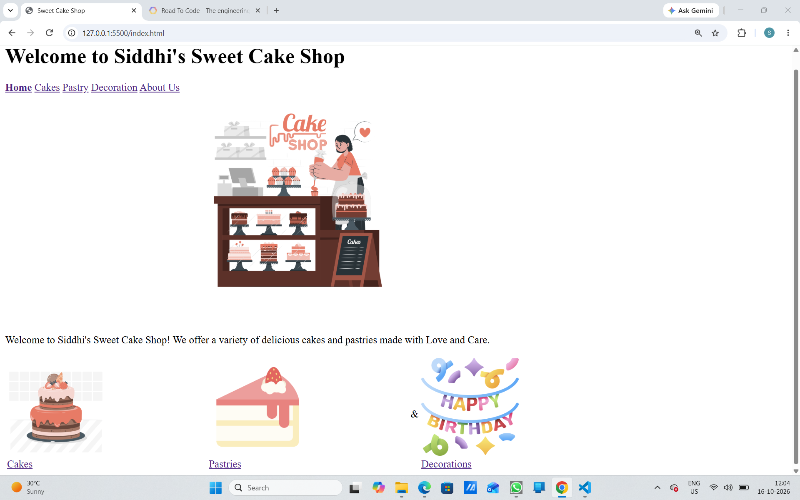
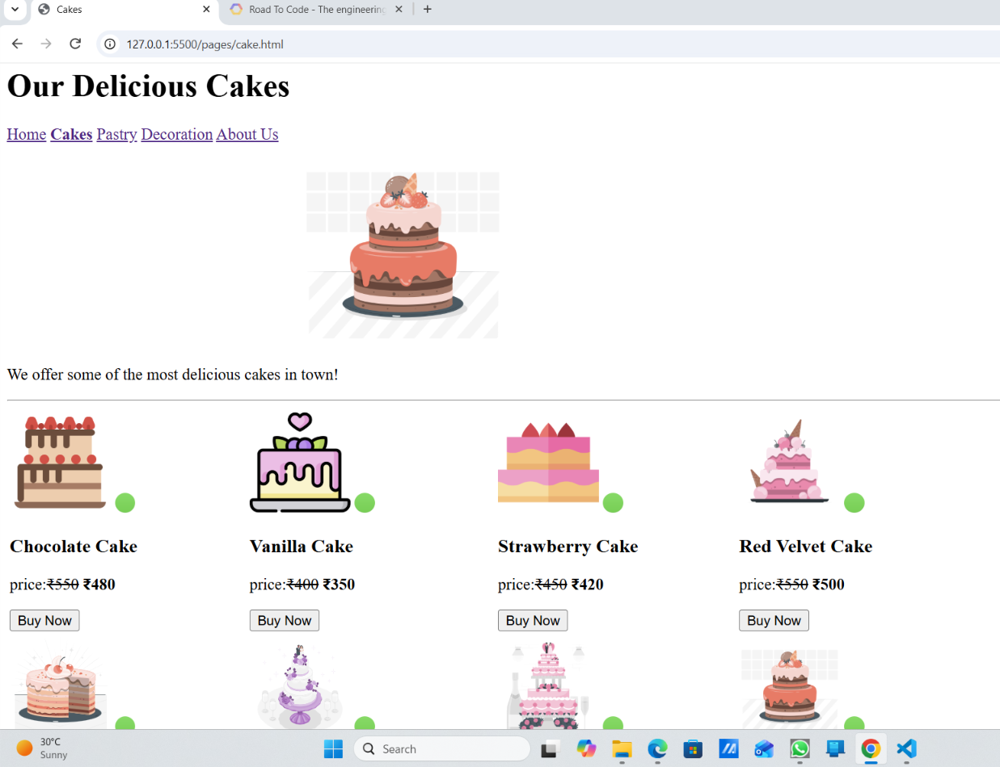

# Cake Shop Website 🎂

## About the Project
This is a simple Cake Shop website created using HTML as part of my web development learning.The Cake Shop Website is a simple and attractive website developed using HTML. The main purpose of this project is to provide information about different types of cakes, pastries, cake decorations, and other bakery products in one place.

This website is designed for customers who want to explore different cake varieties, learn about cake decoration options, and find suitable cakes for birthdays, anniversaries, weddings, and other special occasions.

## pages:
- Home 
- Cakes
- Decoration
- Pastry
- About
  
  
  
  
## Technologies Used
- HTML

   